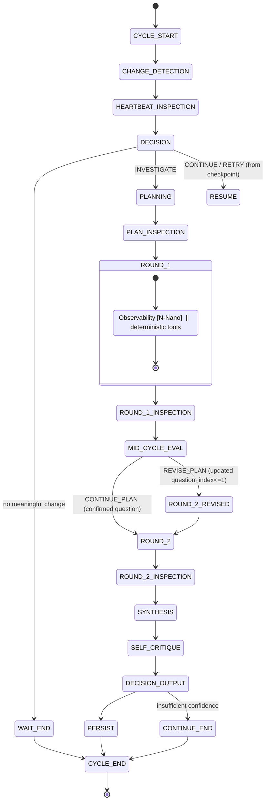

# ADR-0003: Two-round investigation contract

- **Status:** Accepted
- **Date:** 2026-07-18
- **Deciders:** Architecture expert, root coordinator
- **Wave:** 1 (foundation)
- **Related:** ADR-0001 (package/ports), ADR-0002 (checkpoints + revision persistence)

## Context

The P0 investigation is a **two-round** state machine with a bounded mid-cycle
revision, not the "all specialists concurrent" fan-out drawn in PRD §8 and
§18.2. This ADR fixes the state machine so `core_developer` (orchestrator +
state), `inference_engineer` (six model calls + specialists), and
`security_expert` (inspection stages) implement the same contract, and so the
persisted revision record feeds the learning loop.

For P0, **Observability and Platform are the only specialist-model workers.**
Historian retrieval is deterministic (`search_episodes`, `search_skills`).
Security interpretation and the **Critic role are a second Nemotron-Super call**
with an adversarial prompt. Standalone Historian/Security/Critic specialists are
P2 (AGENTS.md; PRD §9.5–9.7; FR-5).

Traceability: FR-3 (FR3-07…FR3-10), FR-4, FR-5 (FR5-01, FR5-02, FR5-07, FR5-08),
FR-6, FR-13; PRD §8, §11.2, §13.1a, §21.1; acceptance "mid-cycle evaluation
fires after Round 1 and produces a logged CONTINUE_PLAN or REVISE_PLAN decision
before Platform runs".

## Decision

### 1. State machine

Ordered phases; each transition is committed with a checkpoint (ADR-0002 §4).
The six model calls (FR-13, inference_engineer's six P0 calls) are marked
**[N-Super]** (Nemotron-Super, strategic) or **[N-Nano]** (Nemotron-Nano,
specialist). HiddenLayer inspection stages are marked **[HL]**.

| # | Phase | Actor | Persists |
|---|---|---|---|
| 1 | `CYCLE_START` | orchestrator | `cycles` row, `state_before` |
| 2 | `CHANGE_DETECTION` | deterministic | signals checked, changes |
| 3 | `HEARTBEAT_INSPECTION` **[HL]** | security gateway | `security_decisions` (heartbeat_input, retrieved_content) |
| 4 | `DECISION` | **[N-Super]** heartbeat interp | `cycles.decision` ∈ WAIT/INVESTIGATE/CONTINUE/RETRY/LEARN/ESCALATE/REQUEST_APPROVAL/CONTAIN |
| 5 | `PLANNING` | **[N-Super]** call 1 (plan) | `plans` (bounded plan; FR3-01…06) |
| 6 | `PLAN_INSPECTION` **[HL]** | security gateway | `security_decisions` (model_prompt) |
| 7 | `ROUND_1` | **[N-Nano]** call 2 (Observability) **∥** deterministic tools | `evidence`, `tool_calls`, `specialist_findings`, `model_calls` |
| 8 | `ROUND_1_INSPECTION` **[HL]** | security gateway | `security_decisions` (tool_result, specialist_response) |
| 9 | `MID_CYCLE_EVAL` | **[N-Super]** call 3 | `plan_revisions` (CONTINUE_PLAN \| REVISE_PLAN) |
| 10 | `ROUND_2` | **[N-Nano]** call 4 (Platform, confirmed/revised question) | `evidence`, `tool_calls`, `specialist_findings`, `model_calls` |
| 11 | `ROUND_2_INSPECTION` **[HL]** | security gateway | `security_decisions` (specialist_response) |
| 12 | `SYNTHESIS` | **[N-Super]** call 5 | `incidents.assessment`, confidence, recommendation |
| 13 | `SELF_CRITIQUE` | **[N-Super]** call 6 (adversarial; Critic role) | updated confidence / unsupported-claim flags |
| 14 | `DECISION_OUTPUT` | orchestrator (+ approval if required) | final decision, approval request |
| 15 | `PERSIST` **[HL]** | security gateway + repo | memory_write/skill_write inspection, `cycles.state_after`, episode handoff |
| 16 | `CYCLE_END` | orchestrator | terminal state; hand off to learning |

**Key ordering guarantees (must hold in P0):**

- Round 1 runs the Observability specialist **concurrently with deterministic
  tools** (FR3-07, FR5-07). The two *specialists* are **never** run in parallel:
  Platform starts only after `MID_CYCLE_EVAL` (inference_engineer constraint;
  contradicts PRD §18.2 — see architecture.md resolution).
- `MID_CYCLE_EVAL` fires exactly once, after Round 1, before Round 2 (FR3-08).
- At most **one** revision per cycle (FR3-10); `revision_index` is capped at 1.
- Every phase that consumes untrusted content or emits a persistent write is
  preceded/followed by a HiddenLayer inspection stage; fail-closed applies to
  tool calls and persistent writes (AGENTS.md; FR10-06).



### 2. Mid-cycle evaluation contract

`MID_CYCLE_EVAL` is a single bounded Nemotron-Super call
(`ATHENA_*` budget: `mid_cycle_evaluation.max_tokens` per PRD §11.2 example,
`deadline_seconds` ≈ 10). Input: the plan's original hypothesis + Round 1
Observability finding + Round 1 deterministic evidence (by ID). Output is a
structured decision:

```json
{
  "decision": "REVISE_PLAN",
  "reason": "Round 1 shows errors originate at the downstream Redis dependency, not the calling service.",
  "trigger_evidence_ids": ["ev_redis_42", "ev_api_19"],
  "confirmed_platform_question": null,
  "updated_platform_question": "Did a deployment change the Redis connection-pool size, causing connection rejection?"
}
```

- `CONTINUE_PLAN`: Round 2 uses the plan's original Platform question;
  `updated_platform_question` is null.
- `REVISE_PLAN`: Round 2 uses `updated_platform_question`; a `plan_revisions`
  row is written (ADR-0002). Only permitted while `revision_index == 0`;
  a second revision attempt is rejected and the confirmed question is used.

### 3. Persisted revision record (FR3-10)

Written to `plan_revisions` on **every** mid-cycle evaluation (both outcomes, so
CONTINUE_PLAN is auditable too), keyed to the cycle:

| Field | Meaning |
|---|---|
| `original_platform_question` / `original_scope_json` | Platform scope as planned before Round 1 evidence |
| `decision` | `CONTINUE_PLAN` or `REVISE_PLAN` |
| `trigger_reason` | Why the hypothesis held or was redirected |
| `trigger_evidence_ids_json` | Observability/tool evidence IDs that drove the decision |
| `updated_platform_question` | Confirmed (== original) or revised question actually sent to Round 2 |
| `revision_index` | 0 for the first evaluation; enforced ≤ 1 |

**Negative-knowledge handoff (FR8-09):** a `REVISE_PLAN` row is the source of a
`known_false_leads` entry in the learned skill — the abandoned hypothesis, the
Observability evidence that invalidated it, and the reason. `recursive_learning_expert`
reads `plan_revisions` + disproved hypotheses to populate
`skills.known_false_leads_json` (PRD §13.1a, §13.4).

### 4. Budgets and stop conditions

The plan (ADR-0002 `plans`) enforces, from `.env.example` / PRD §11.2:
`max_specialists=2` (`ATHENA_MAX_SPECIALISTS`), `max_total_tokens=14000`
(`ATHENA_MAX_TOTAL_TOKENS`), per-round tool/token/deadline budgets, and
`deadline_seconds=75` (`ATHENA_INVESTIGATION_DEADLINE_SECONDS`) as the enforced
hard bound. Stop conditions: `root_cause_confidence >= 0.85`,
`critical_containment_action_identified`, `no_new_evidence_after_two_queries`,
or deadline. Deadline/stop before Round 2 downgrades cleanly to a `CONTINUE`
(Level-2 recovery, ADR-0002 §5) rather than an unbounded run.

### 5. Structured output and repair

Every model call returns schema-validated JSON with at most **one repair retry**
(AGENTS.md; FR5-08). Specialists receive one narrow question, an allowlisted
evidence-ID bundle, explicit prohibitions (no final remediation), an output
schema, a confidence rubric, and a missing-evidence field (PRD §10.4). A finding
citing an evidence ID outside its allowlist is rejected.

## Consequences

- **Positive:** deterministic, checkpointable, auditable investigation; the
  revision is a first-class, learnable record; specialist budget capped at two
  models; the demo's REVISE_PLAN moment (Incident One, PRD §21.1 step 5) is
  explicit and dashboard-visible.
- **Negative / trade-offs:** sequential specialists are slower than a full
  fan-out, but the two-round design is the product thesis (targeted Round 2, no
  wasted budget) and keeps within the 75s bound. Concurrency is still
  demonstrated intra-round (Observability ∥ tools) and across the six vLLM calls'
  throughput metrics.
- **Follow-ups:** `inference_engineer` implements the six prompts/schemas and
  proves Platform starts after mid-cycle eval; `core_developer` implements the
  orchestrator, phase checkpoints, and revision persistence; `security_expert`
  supplies the inspection stages at phases 3, 6, 8, 11, 15.

## Alternatives considered

- **All specialists concurrent (PRD §18.2 / §8):** rejected for P0 — removes the
  mid-cycle revision that is the recursive-within-cycle thesis and exceeds the
  two-specialist budget. Retained as a P2 direction.
- **Unbounded revisions:** rejected — non-deterministic cost/latency; FR3-10
  fixes one revision per cycle.
- **Skip self-critique when confidence is high:** rejected for P0 — the Critic
  role (adversarial N-Super) must always run before a recommendation
  (PRD §18.3; acceptance "Critic validation is shown").
