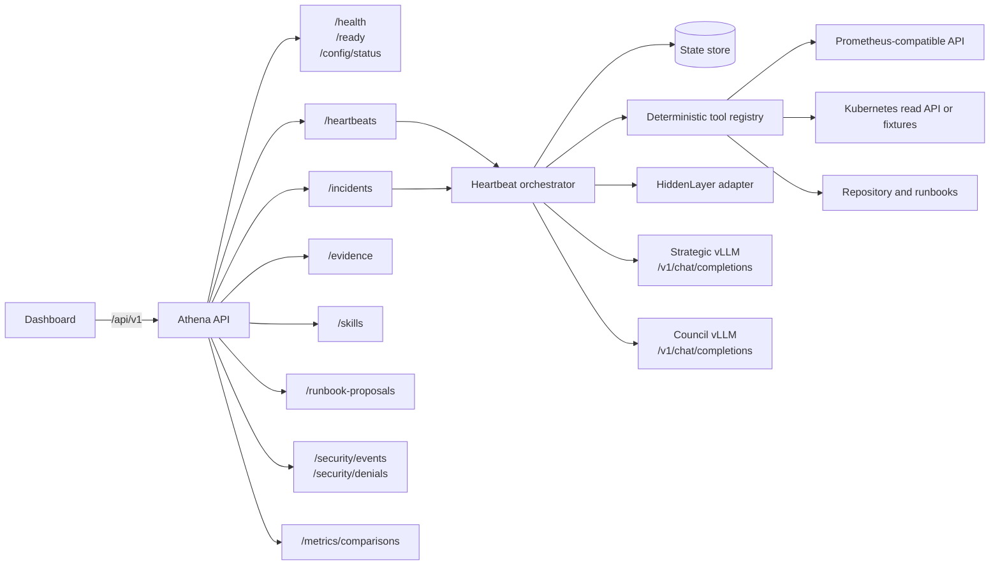
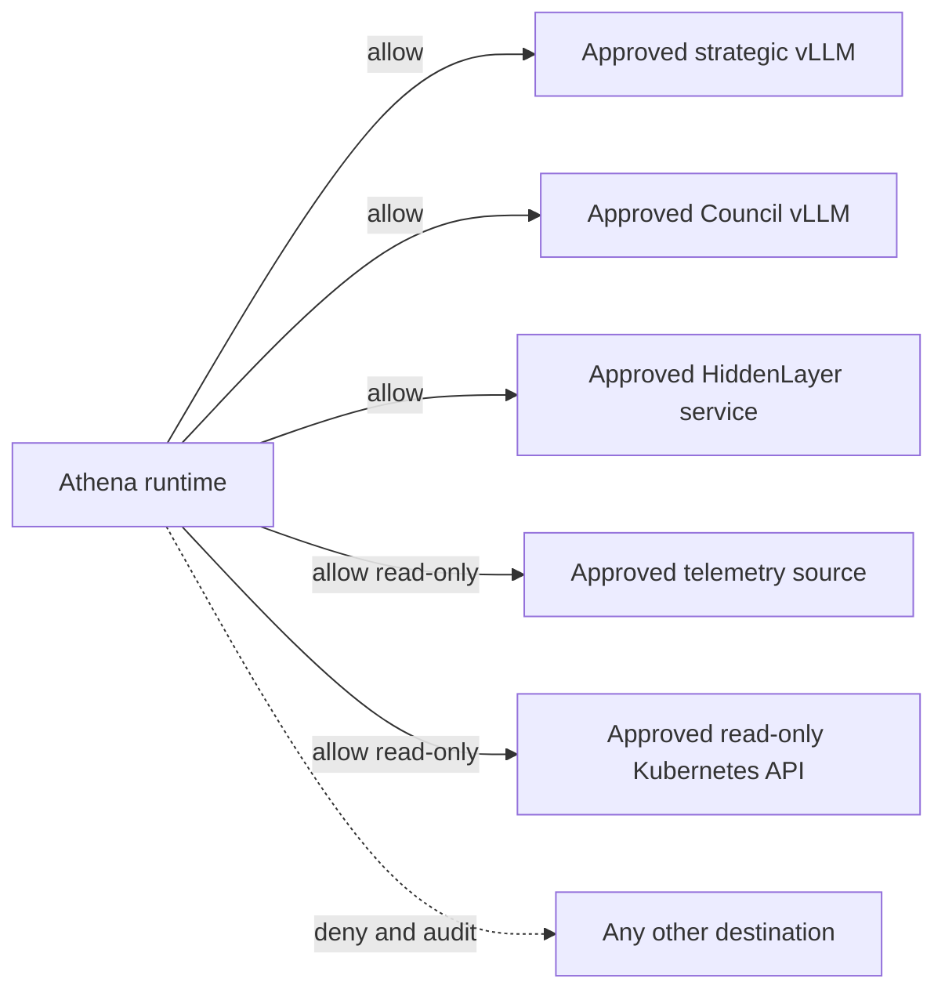

# API and endpoint map

This document defines the proposed MVP endpoint layout. Routes are contracts for implementation planning and should be considered unavailable until their corresponding backlog tasks are complete.

## Endpoint topology



## Conventions

- **Application base URL:** `http://localhost:8000`
- **API prefix:** `/api/v1`
- **Content type:** `application/json`
- **Event stream:** Server-Sent Events using `text/event-stream`
- **Identifiers:** stable prefixed IDs such as `cycle_`, `inc_`, `ev_`, `skill_`, `rbp_`, and `sec_`
- **Timestamps:** UTC RFC 3339 strings
- **Pagination:** cursor-based using `limit` and `cursor`
- **Mutation safety:** `Idempotency-Key` is required for manual heartbeats, verification, approval, validation, and promotion commands
- **Correlation:** every response includes `request_id`; cycle-bound responses also include `cycle_id`
- **Security:** externally exposed deployments require authentication; authorization is role- and action-specific

## Route tree

```text
/api/v1
├── /health
├── /ready
├── /config/status
├── /heartbeats
│   ├── POST /
│   ├── GET  /{cycle_id}
│   ├── GET  /{cycle_id}/events
│   └── POST /{cycle_id}/cancel
├── /incidents
│   ├── GET  /
│   ├── GET  /{incident_id}
│   ├── GET  /{incident_id}/timeline
│   ├── GET  /{incident_id}/evidence
│   ├── POST /{incident_id}/verify
│   └── POST /{incident_id}/approvals
├── /evidence
│   └── GET  /{evidence_id}
├── /skills
│   ├── GET  /
│   ├── GET  /{skill_id}
│   ├── POST /{skill_id}/validate
│   └── POST /{skill_id}/promote
├── /runbook-proposals
│   ├── GET  /
│   ├── GET  /{proposal_id}
│   └── POST /{proposal_id}/approvals
├── /security
│   ├── GET  /events
│   ├── GET  /events/{security_event_id}
│   └── GET  /denials
└── /metrics
    ├── GET  /cycles/{cycle_id}
    └── GET  /comparisons/{comparison_id}
```

## System routes

| Method | Route | Purpose | Access |
|---|---|---|---|
| `GET` | `/api/v1/health` | Process liveness only | Public inside the runtime network |
| `GET` | `/api/v1/ready` | Storage, security gateway, and required inference readiness | Operator |
| `GET` | `/api/v1/config/status` | Sanitized provider, model-tier, policy-version, and degraded-mode status | Operator |

Health responses must never expose credentials, raw environment variables, protected paths, or full provider URLs containing secrets.

## Heartbeat routes

| Method | Route | Purpose | Access | Requirement |
|---|---|---|---|---|
| `POST` | `/api/v1/heartbeats` | Trigger a manual heartbeat | Operator | FR-1 |
| `GET` | `/api/v1/heartbeats/{cycle_id}` | Read cycle state, decision, plan summary, and metrics | Viewer | FR-1, FR-7 |
| `GET` | `/api/v1/heartbeats/{cycle_id}/events` | Stream sanitized cycle transitions and Council progress | Viewer | FR-1, FR-12 |
| `POST` | `/api/v1/heartbeats/{cycle_id}/cancel` | Request bounded cancellation at the next safe checkpoint | Operator | FR-3, FR-7 |

Scheduled cycles enter through the same internal command handler as `POST /heartbeats`, ensuring manual and autonomous behavior share validation, locking, persistence, and security rules.

### Manual heartbeat request

```json
{
  "trigger": "manual",
  "fixture": "redis-incident-001",
  "reason": "demo run"
}
```

`fixture` is allowed only in development or demo mode and must be rejected in production mode.

### Accepted response

```json
{
  "request_id": "req_01",
  "cycle_id": "cycle_018",
  "status": "queued",
  "links": {
    "self": "/api/v1/heartbeats/cycle_018",
    "events": "/api/v1/heartbeats/cycle_018/events"
  }
}
```

## Incident and evidence routes

| Method | Route | Purpose | Access | Requirement |
|---|---|---|---|---|
| `GET` | `/api/v1/incidents` | List incidents by state, service, severity, or time | Viewer | FR-7 |
| `GET` | `/api/v1/incidents/{incident_id}` | Read the final assessment, confidence, recommendation, and status | Viewer | FR-6, FR-7 |
| `GET` | `/api/v1/incidents/{incident_id}/timeline` | Read ordered evidence and decision events | Viewer | FR-6 |
| `GET` | `/api/v1/incidents/{incident_id}/evidence` | List evidence references used by the incident | Viewer | FR-6 |
| `POST` | `/api/v1/incidents/{incident_id}/verify` | Record fixture-ground-truth or authorized human verification | Reviewer | FR-8 |
| `POST` | `/api/v1/incidents/{incident_id}/approvals` | Approve or reject a proposed operational action | Approver | FR-3, FR-11 |
| `GET` | `/api/v1/evidence/{evidence_id}` | Read one sanitized evidence envelope and provenance | Viewer | FR-6 |

Verification and approval are separate actions. Verifying an outcome permits learning; approving an action permits an otherwise approval-gated capability.

## Skill and runbook routes

| Method | Route | Purpose | Access | Requirement |
|---|---|---|---|---|
| `GET` | `/api/v1/skills` | List skills by lifecycle state, domain, or trigger | Viewer | FR-8 |
| `GET` | `/api/v1/skills/{skill_id}` | Read a skill, provenance, security status, and validation history | Viewer | FR-8 |
| `POST` | `/api/v1/skills/{skill_id}/validate` | Queue deterministic replay for a candidate or shadow skill | Operator | FR-8 |
| `POST` | `/api/v1/skills/{skill_id}/promote` | Promote only after policy, replay, evidence, and approval checks | Reviewer | FR-8, FR-10 |
| `GET` | `/api/v1/runbook-proposals` | List reviewable proposals | Viewer | FR-9 |
| `GET` | `/api/v1/runbook-proposals/{proposal_id}` | Read diff, provenance, risk, and reviewer requirements | Viewer | FR-9 |
| `POST` | `/api/v1/runbook-proposals/{proposal_id}/approvals` | Approve or reject a proposal without mutating the source | Reviewer | FR-9, FR-11 |

Promotion must return a conflict when the skill is unscanned, replay has failed, required evidence is missing, a security finding is unresolved, or risk-based approval is absent.

## Security and measurement routes

| Method | Route | Purpose | Access | Requirement |
|---|---|---|---|---|
| `GET` | `/api/v1/security/events` | List HiddenLayer findings and security incidents | Security viewer | FR-10 |
| `GET` | `/api/v1/security/events/{security_event_id}` | Read a sanitized finding, trust change, and agent effect | Security viewer | FR-10 |
| `GET` | `/api/v1/security/denials` | List OpenShell denials and approval-gated actions | Security viewer | FR-11 |
| `GET` | `/api/v1/metrics/cycles/{cycle_id}` | Read model, tool, latency, token, and security metrics | Viewer | FR-12, FR-14 |
| `GET` | `/api/v1/metrics/comparisons/{comparison_id}` | Compare first and learned incidents | Viewer | FR-14 |

Raw malicious content, secrets, protected paths, and sensitive prompt bodies must not be returned by dashboard-facing security routes.

## Internal component interfaces

These are typed application interfaces, not public HTTP routes.

| Interface | Operation | Producer | Consumer |
|---|---|---|---|
| `HeartbeatCommand` | start, continue, retry, cancel | Scheduler or API | Heartbeat orchestrator |
| `InvestigationPlan` | validate bounded plan | Nemotron planner | Orchestrator and router |
| `ToolRequest` | invoke approved deterministic capability | Router | Tool registry |
| `EvidenceEnvelope` | register immutable fact and provenance | Tool registry | Evidence registry |
| `SpecialistTask` | execute one bounded question | Router | Council client |
| `SpecialistFinding` | return structured interpretation | Council client | Synthesizer |
| `SecurityInspection` | inspect information transition | Any boundary adapter | HiddenLayer gateway |
| `PolicyDecision` | allow, deny, or request approval | Tool executor | OpenShell runtime |
| `MemoryWriteCandidate` | scan and commit state or learning | Orchestrator | Security gateway and store |
| `ReplayRequest` | validate candidate skill | Learning service | Replay runner |

## Outbound endpoint adapters

All outbound endpoints are configurable and allowlisted. The application must expose a single internal adapter contract for each dependency so fallback behavior does not alter Athena's schemas.

| Dependency | Suggested configuration | Protocol or path | Policy |
|---|---|---|---|
| Strategic vLLM | `ATHENA_MAIN_MODEL_BASE_URL` | OpenAI-compatible `/v1/chat/completions` | Allowlisted; strategic tasks only |
| Council vLLM | `ATHENA_COUNCIL_MODEL_BASE_URL` | OpenAI-compatible `/v1/chat/completions` | Allowlisted; bounded tasks only |
| HiddenLayer | `ATHENA_SECURITY_BASE_URL` | Vendor adapter owned by the security gateway | Required for actionable calls and writes |
| Prometheus | `ATHENA_PROMETHEUS_BASE_URL` | `/api/v1/query` and `/api/v1/query_range` | Read-only queries |
| Kubernetes | kubeconfig alias or fixture adapter | Read-only Kubernetes API operations | No mutation verbs |
| Repository | monitored workspace path | Sandboxed filesystem operations | Read source; write proposals only |
| OpenRouter fallback | `ATHENA_FALLBACK_MODEL_BASE_URL` | OpenAI-compatible API | Disabled by default; sanitized data only |

No specialist receives dependency credentials or arbitrary endpoint selection. The orchestrator selects a named adapter, and OpenShell enforces the resolved destination.

## Network policy layout



## Standard error envelope

```json
{
  "request_id": "req_01",
  "cycle_id": "cycle_018",
  "error": {
    "code": "SECURITY_POLICY_DENIED",
    "message": "The requested action is not permitted.",
    "retryable": false,
    "details": {
      "security_event_id": "sec_1042"
    }
  }
}
```

Error messages returned to clients remain sanitized. Full diagnostics stay in the protected audit record.

## Recommended HTTP behavior

| Situation | Status |
|---|---:|
| Manual heartbeat accepted | `202` |
| Successful read | `200` |
| Schema validation failure | `422` |
| Missing or invalid authentication | `401` |
| Authenticated but unauthorized | `403` |
| Unknown resource | `404` |
| Idempotency or lifecycle conflict | `409` |
| Rate or investigation-budget limit | `429` |
| Required dependency unavailable | `503` |
| Security or capability policy denial | `403` with sanitized security reference |

## MVP implementation order

1. `GET /health`, `GET /ready`, and `POST /heartbeats`
2. Heartbeat status and event stream
3. Incident, timeline, and evidence reads
4. Verification and approval commands
5. Skill reads and replay validation
6. Security events and denials
7. Metrics comparison
8. Runbook proposal reads and approvals
