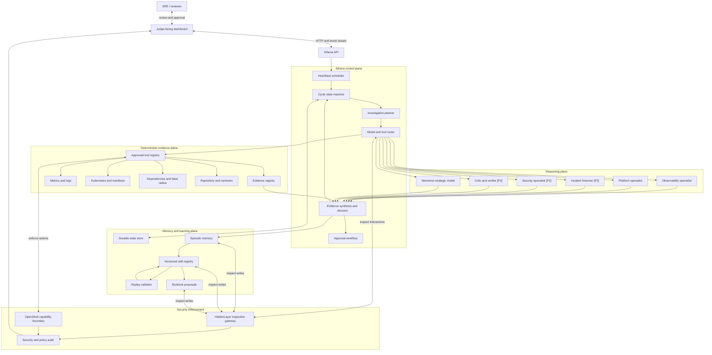
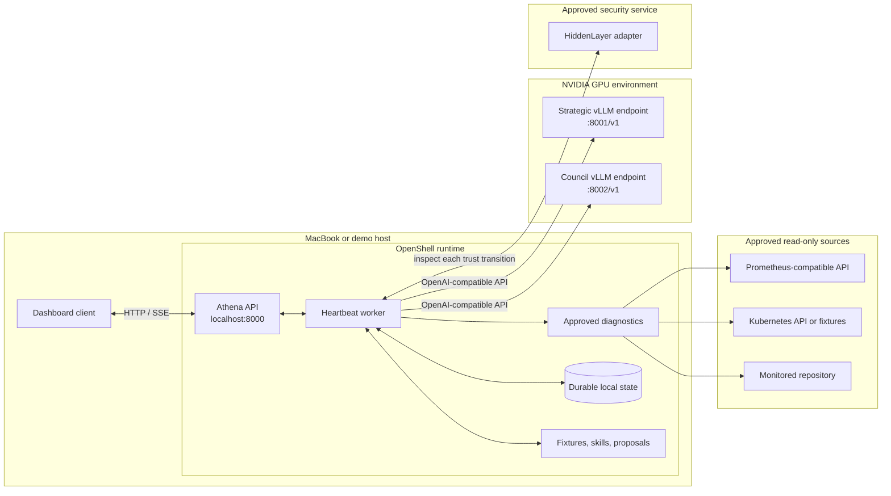
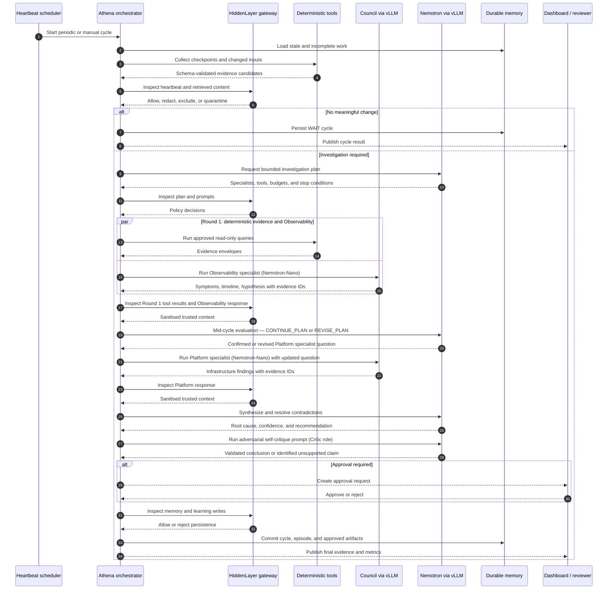
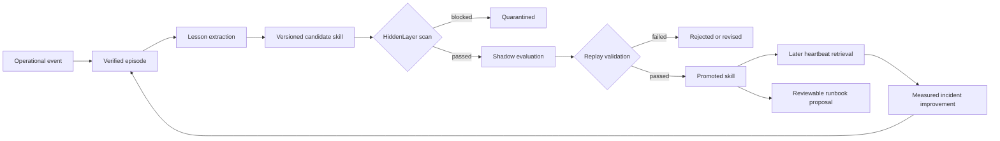
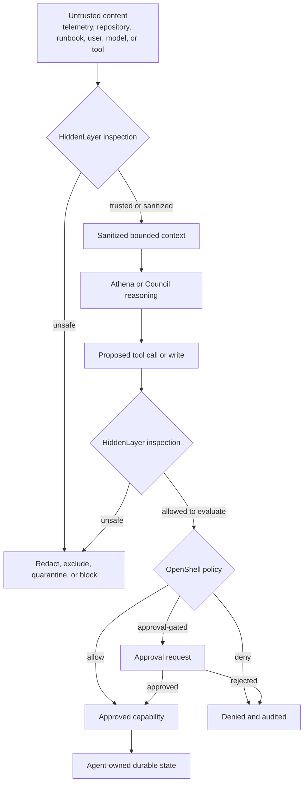

# Athena architecture

This document translates the proposal into a buildable logical and runtime architecture. The diagrams describe the target MVP; they do not imply that the components are already implemented.

## Logical component architecture

### Ownership boundaries

| Component | Owns | Must not own |
|---|---|---|
| Athena control plane | Heartbeat, plans, budgets, routing, synthesis, decisions, recovery | Unrestricted execution or security-policy bypass |
| Deterministic evidence plane | Fact collection, parsing, diffs, graph traversal, policy checks | Root-cause judgment |
| Council | Narrow interpretation of explicitly supplied evidence | Persistent goals, broad retrieval, final decision authority |
| Nemotron | Strategic planning, cross-domain synthesis, contradiction resolution, learning | Direct production mutation |
| HiddenLayer | Trust inspection and content-policy decisions | Filesystem or network enforcement |
| OpenShell | Filesystem, process, credential, and egress enforcement | Semantic trust decisions |
| Memory and learning | Durable episodes, patterns, skills, validation history, proposals | Promotion of unverified or quarantined material |

## Runtime and deployment layout

The MVP can run its application and state locally while using configurable GPU inference endpoints. OpenShell encloses application capabilities, while HiddenLayer remains on every required information boundary.

Ports in this diagram are recommended development defaults and must remain configurable. HiddenLayer and source endpoints are configured through allowlisted adapters rather than hard-coded vendor locations.

## Heartbeat and investigation sequence

## Recursive learning lifecycle

Promotion requires evidence provenance, security history, replay results, versioning, and any risk-based human approval. Quarantined artifacts never enter historian retrieval.

## Trust-boundary enforcement

HiddenLayer answers whether content or intent should be trusted. OpenShell independently determines whether the resulting action is technically permitted.

## Requirement traceability

| Architecture view | Primary requirements |
|---|---|
| Logical component architecture | FR-3, FR-4, FR-5, FR-6, FR-7, FR-13 |
| Runtime and deployment layout | FR-10, FR-11, FR-12 |
| Heartbeat sequence | FR-1, FR-2, FR-3, FR-6, FR-7 |
| Recursive learning lifecycle | FR-8, FR-9, FR-14 |
| Trust-boundary enforcement | FR-10, FR-11 |

## Contract inventory

This inventory fixes the shared boundaries between the P0 planes so agents
building concurrently converge. Each row lists **owner module (owning agent)**,
**input**, **output**, **persistence behavior** (per ADR-0002), and **failure
mode**. Contracts are the typed application interfaces from
`docs/api-endpoints.md` "Internal component interfaces". Canonical cross-cutting
Pydantic schemas live in the core-owned module `app/athena/schemas.py`
(ADR-0001); security contracts live in `app/security/contracts.py`; skill and
episode schemas live in `app/learning/`.

| Contract | Owner module (agent) | Input | Output | Persistence | Failure mode |
|---|---|---|---|---|---|
| `HeartbeatCommand` | `app/heartbeat/` (core_developer) | trigger (periodic\|manual), optional `fixture`, reason, `Idempotency-Key` | accepted `cycle_id`, queued status | Creates `cycles` row at `CYCLE_START`; overlap lock prevents concurrent cycles (FR1-06) | Reject `fixture` in production mode (422); duplicate idempotency key → return existing cycle (409/idempotent) |
| `InvestigationPlan` | schema in `app/athena/schemas.py` (core); produced by Nemotron-Super planner in `app/routing/` (inference_engineer) | heartbeat context, changed inputs, retrieved skills/episodes | bounded plan: per-round specialists/tools/tokens/deadline, `max_specialists=2`, `max_total_tokens`, stop conditions, security posture | `plans` row at `PLANNING` (ADR-0002) | Plan omitting mandatory bounds or exceeding policy is rejected (FR3-06); no specialist/tool runs without a valid plan |
| `ToolRequest` | `app/tools/` registry (core_developer); routed by `app/routing/` (inference_engineer) | named approved tool, allowlisted args | invokes deterministic capability | Not itself persisted; effects captured as `EvidenceEnvelope` + `tool_calls` | Unknown/unapproved tool denied; every call has a timeout and bounded retry (AGENTS.md) |
| `EvidenceEnvelope` | `app/tools/` + evidence registry (core_developer); schema in `app/athena/schemas.py` | tool result: id, type, source, query, window, value, summary, provenance | immutable registered fact with `evidence_id`, `content_hash`, `trust_score` | Append-only `evidence` row; **fact plane**, never overwritten (FR6-01) | Untrusted until schema validation **and** HiddenLayer `tool_result` inspection pass; on fail → excluded/quarantined |
| `SpecialistTask` | `app/council/` (inference_engineer); schema in `app/athena/schemas.py` | role, one narrow question, allowlisted evidence IDs, allowed tools, prohibitions, output schema, confidence rubric | dispatched N-Nano call (Observability round 1 / Platform round 2) | `model_calls` row per invocation (FR4-04) | Specialist cannot pick arbitrary endpoints/tools or make the final decision; degraded mode bounded |
| `SpecialistFinding` | `app/council/` (inference_engineer); schema in `app/athena/schemas.py` | model JSON: facts, hypothesis, cited evidence IDs, confidence, missing evidence | validated finding consumed by synthesizer | `specialist_findings` row; **interpretation plane**, kept off the fact plane | Schema-invalid → one repair retry then reject; citation outside evidence allowlist rejected (FR5-08) |
| `SecurityInspection` | `app/security/contracts.py` + gateway (security_expert) | `InspectionRequest`: `InspectionStage`, producer, consumer, content ref, cycle_id | `SecurityDecision`: action ∈ `allow`\|`redact`\|`exclude`\|`quarantine`\|`block`\|`reject_persistence`, agent_effect, trust change | `security_decisions` row (sanitized; FR10-04) | **Fail closed** for tool calls and persistent writes when inspection unavailable; restricted-mode continue only for non-actionable summaries (FR10-06/07) |
| `PolicyDecision` | `app/policies/` OpenShell engine (security_expert) | proposed action, resolved target/destination | allow \| deny \| approval-gated | `openshell_denials` row for denials/approval-gated (FR11); **independent of HiddenLayer trust** | Deny protected credential paths, unapproved egress, production mutation, policy changes; approval-gated actions pause for reviewer |
| `MemoryWriteCandidate` | orchestrator `app/athena/` (core) → gateway (security) → repo `app/memory/` (core); learning writes via `app/learning/` | candidate cycle/episode/skill/proposal payload | committed durable record **or** rejection/quarantine | `episodes`/`skills`/`runbook_proposals` after HiddenLayer `memory_write`/`skill_write`/`runbook_write` passes | Poisoned or unscanned content → `reject_persistence`; quarantined artifacts never enter retrieval (FR8-08) |
| `ReplayRequest` | `app/learning/` replay runner (recursive_learning_expert) | candidate skill + positive/negative/contradictory fixtures | pass/fail with recorded validation history | Updates `skills.validation_passes`/`status`; drives promotion | Replay failure blocks promotion (409 on `POST /skills/{id}/promote`); no promotion without security scan + replay (FR8-06) |

### Shared ports (cross-agent, recorded for convergence)

- **SecurityGateway** — Protocol `inspect(request: InspectionRequest) ->
  SecurityDecision` in `app/security/contracts.py` (owned by **security_expert**),
  with an `InspectionStage` enum covering the PRD §14.2 stages
  (`heartbeat_input`, `retrieved_content`, `user_prompt`, `model_prompt`,
  `specialist_response`, `athena_response`, `tool_call`, `tool_result`,
  `memory_write`, `skill_write`, `runbook_write`). Core, routing, tools, and
  learning **depend on this Protocol**; none re-declares it. Wave 1 ships a
  deterministic local adapter; live HiddenLayer is config-selected
  (`ATHENA_SECURITY_MODE`).
- **InferencePort** — OpenAI-compatible chat/completions Protocol **defined by
  core** in `app/athena/ports.py` and consumed by the orchestrator/router. Core
  ships a deterministic mock in Wave 1; **inference_engineer** implements the
  live vLLM adapter in `app/models/` in Wave 2. No vendor SDK leaks into
  orchestration or Council contracts.

### Contract ownership by agent (non-overlapping)

| Agent | Owns contracts / modules |
|---|---|
| core_developer | `HeartbeatCommand`, `EvidenceEnvelope`+`ToolRequest` registry, canonical `schemas.py`, `ports.py` (InferencePort), repository (`MemoryWriteCandidate` commit) |
| inference_engineer | `InvestigationPlan` producer, `SpecialistTask`/`SpecialistFinding`, vLLM `InferencePort` adapter, six P0 prompts |
| security_expert | `SecurityInspection` (`SecurityGateway`, contracts), `PolicyDecision` (OpenShell) |
| recursive_learning_expert | `ReplayRequest`, skill/episode schemas, `MemoryWriteCandidate` for learning artifacts |
| demo_engineer | fixtures feeding `HeartbeatCommand`/evidence, dashboard consuming read APIs |

## P0-blocking inconsistencies resolved

Per AGENTS.md source-of-truth order (accepted ADRs > FRs > roadmap > PRD), the
following documentation conflicts were resolved to the narrower P0 behavior and
recorded here and in the ADRs.

1. **Specialist concurrency — "all specialists concurrent" vs. two-round
   sequential.** PRD §8 and §18.2 draw Observability, Platform, Historian, and
   Security running in parallel. AGENTS.md, FR-3 (FR3-07…10), and the roadmap
   mandate a two-round flow. **Resolution (ADR-0003):** P0 concurrency is
   **intra-round only** — Observability ∥ deterministic tools in Round 1. The two
   specialists are never parallel; Platform runs after mid-cycle evaluation. The
   PRD fan-out diagram is a P2 direction.

2. **Specialist count — invocation examples call 3–4 specialists.** PRD §11.1
   lists Observability + Platform + Historian + Critic for a high-error alert,
   conflicting with `ATHENA_MAX_SPECIALISTS=2`. **Resolution:** in P0 only
   Observability and Platform are specialist-model workers and count against the
   budget of 2. Historian is deterministic retrieval; Critic is a Nemotron-Super
   prompt — neither consumes the specialist budget (FR-5; AGENTS.md).

3. **Investigation deadline — 75s vs. 90s vs. 90–120s.** NFR Performance targets
   say full investigation < 90s; PRD §11.2 budget and `.env.example`
   (`ATHENA_INVESTIGATION_DEADLINE_SECONDS`) set 75s; PRD §6.1 estimates
   Nemotron-Super full investigation at 90–120s. **Resolution:** the enforced
   contract bound is **75s** (the budget/env value, used as the hard stop
   condition; ADR-0003 §4); < 90s is the NFR target. The 90–120s model estimate
   is a hardware-validation **risk**, not the enforced bound — flagged for
   `inference_engineer` to validate on real vLLM (mitigate with reduced context /
   `CONTINUE` downgrade if exceeded).

4. **Retrieval tool naming — `search_incident_memory` vs. `search_episodes`.**
   PRD §17.2 lists `search_incident_memory`; the P0 priorities list, §9.6, and
   the FR backlog use `search_episodes` + `search_skills`. **Resolution:** P0
   standardizes on **`search_episodes`** and **`search_skills`** (deterministic
   Historian retrieval); `search_incident_memory` is the same capability under
   the older name. `core_developer`/`recursive_learning_expert` implement the
   standardized names.

5. **`app/council/` P2 files in the suggested tree.** PRD §25 shows
   `council/security.py`, `historian.py`, `critic.py`. **Resolution (ADR-0001):**
   not created in P0 — only `observability.py` and `platform.py`. Prevents an
   agent scaffolding P2 specialists.

Non-blocking items (recorded, not resolved here): recommended vLLM/dashboard
port numbers differ across diagrams (`:8000`/`:8001`/`:8002`) — all are
explicitly configurable via `.env.example`, so no ADR is required.
