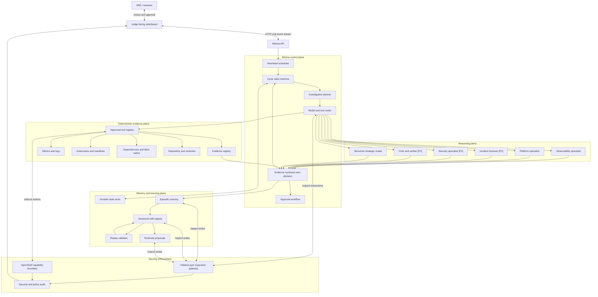
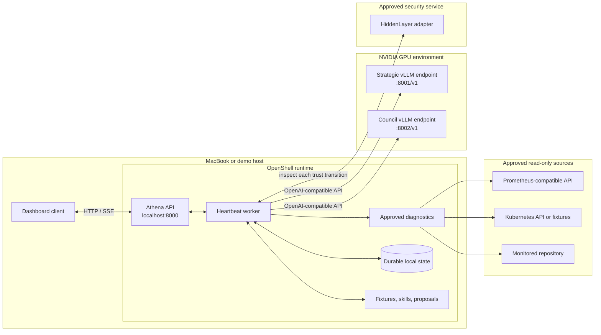
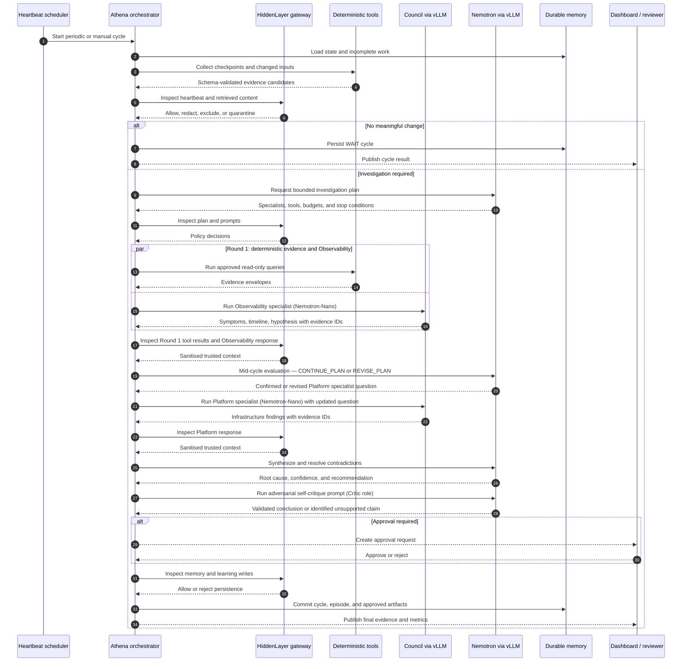
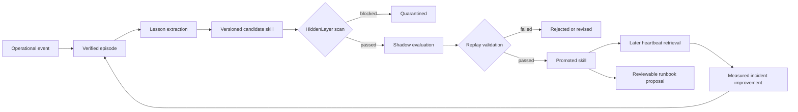
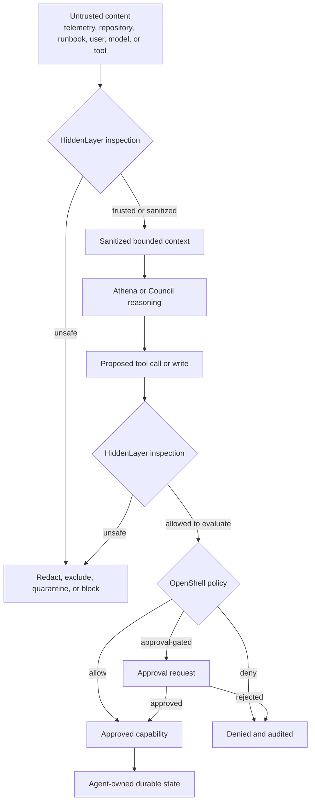

# Athena architecture

This document translates the proposal into a buildable logical and runtime architecture. The diagrams describe the target MVP; they do not imply that the components are already implemented.

## Logical component architecture

### Ownership boundaries

| Component | Owns | Must not own |
|---|---|---|
| Athena control plane | Heartbeat, plans, budgets, routing, synthesis, decisions, recovery | Unrestricted execution or security-policy bypass |
| Deterministic evidence plane | Fact collection, parsing, diffs, graph traversal, policy checks | Root-cause judgment |
| Council | Narrow interpretation of explicitly supplied evidence | Persistent goals, broad retrieval, final decision authority |
| Nemotron | Strategic planning, cross-domain synthesis, contradiction resolution, learning | Direct production mutation |
| HiddenLayer | Trust inspection and content-policy decisions | Filesystem or network enforcement |
| OpenShell | Filesystem, process, credential, and egress enforcement | Semantic trust decisions |
| Memory and learning | Durable episodes, patterns, skills, validation history, proposals | Promotion of unverified or quarantined material |

## Runtime and deployment layout

The MVP can run its application and state locally while using configurable GPU inference endpoints. OpenShell encloses application capabilities, while HiddenLayer remains on every required information boundary.

Ports in this diagram are recommended development defaults and must remain configurable. HiddenLayer and source endpoints are configured through allowlisted adapters rather than hard-coded vendor locations.

## Heartbeat and investigation sequence

## Recursive learning lifecycle

Promotion requires evidence provenance, security history, replay results, versioning, and any risk-based human approval. Quarantined artifacts never enter historian retrieval.

## Trust-boundary enforcement

HiddenLayer answers whether content or intent should be trusted. OpenShell independently determines whether the resulting action is technically permitted.

## Requirement traceability

| Architecture view | Primary requirements |
|---|---|
| Logical component architecture | FR-3, FR-4, FR-5, FR-6, FR-7, FR-13 |
| Runtime and deployment layout | FR-10, FR-11, FR-12 |
| Heartbeat sequence | FR-1, FR-2, FR-3, FR-6, FR-7 |
| Recursive learning lifecycle | FR-8, FR-9, FR-14 |
| Trust-boundary enforcement | FR-10, FR-11 |
